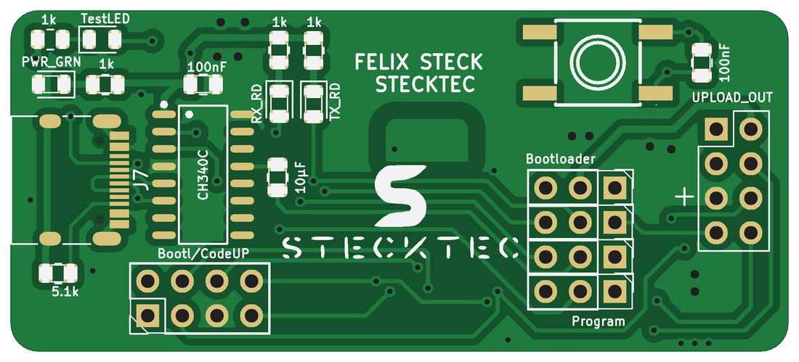
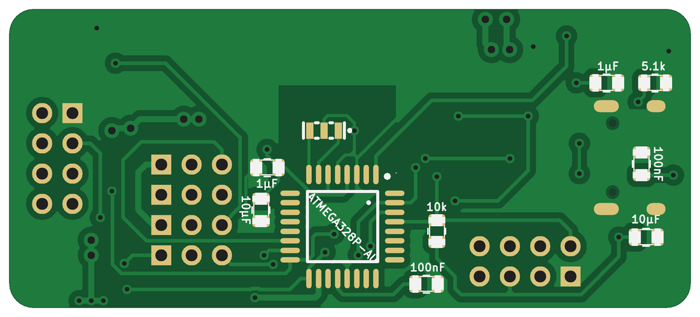
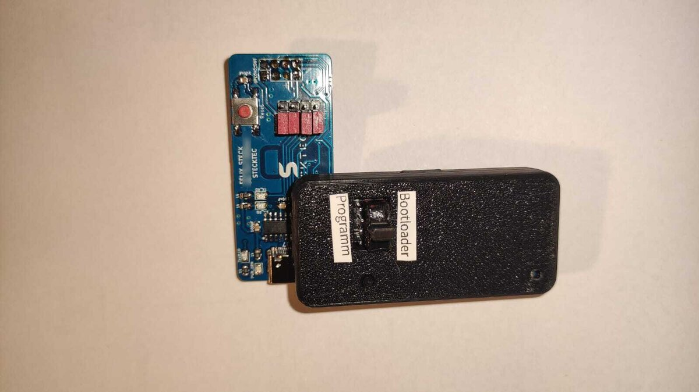
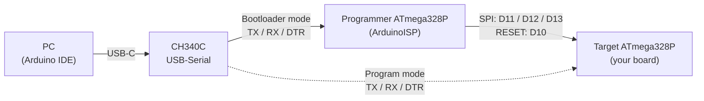
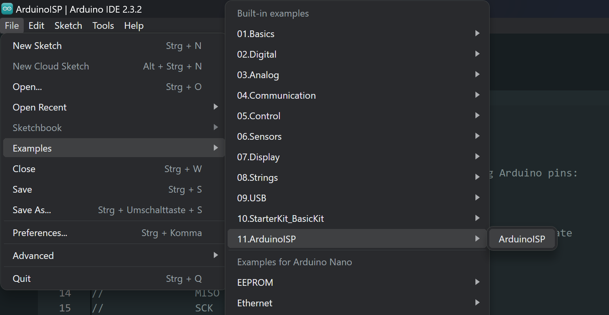
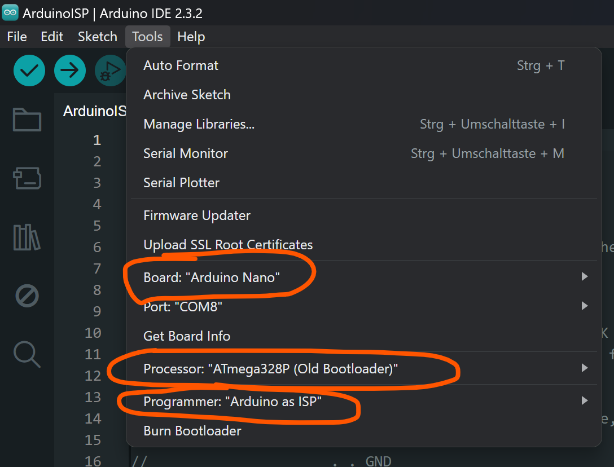
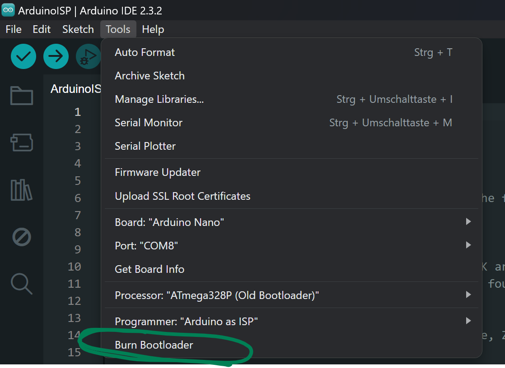
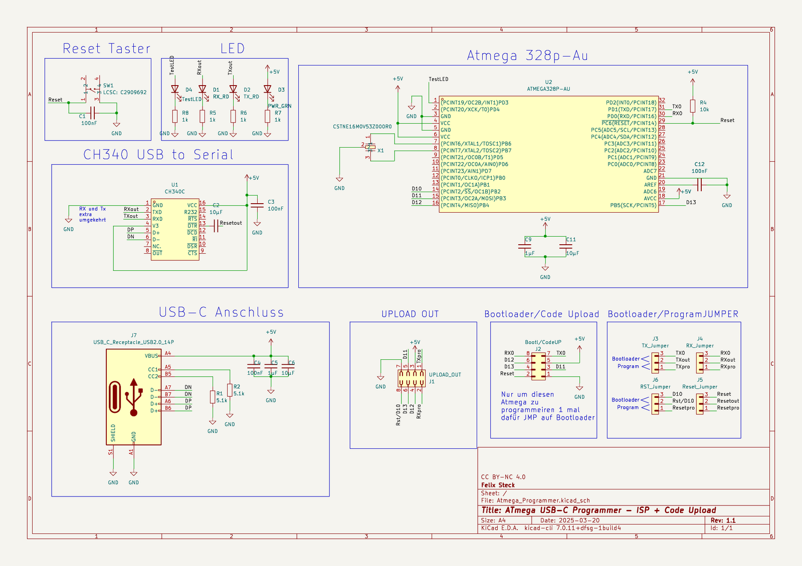
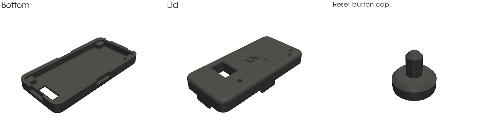

# ATmega USB-C Programmer

**A small USB-C tool for your own ATmega boards (ATmega328P, ATmega2560, ...). It burns the Arduino bootloader and uploads sketches through a single 2×4 pin header, so your PCBs don't need a USB chip.**

<p align="center">
  
  
</p>

## The idea

If you design your own boards around a bare ATmega chip, for example the ATmega328P from the Arduino Uno/Nano or the ATmega2560 from the Arduino Mega, you normally have two annoying options:

- Put a full USB-to-serial circuit (CH340, USB connector, auto-reset) on **every** board. This costs space, money and adds more things that can go wrong.
- Or burn the bootloader with an Arduino Nano and a bunch of jumper wires, and then use a separate USB-serial adapter for every upload.

This programmer combines both jobs in one small device:

1. **Bootloader mode:** The programmer acts as an *Arduino as ISP* and burns the Arduino bootloader onto a brand-new ATmega through the SPI pins.
2. **Program mode:** The programmer's own microcontroller is switched out of the circuit, and the USB-serial converter is connected directly to the target chip. **Programmer + target board together behave exactly like a normal Arduino board** (for example a Nano with an ATmega328P or a Mega with an ATmega2560). You upload sketches and use the Serial Monitor as usual.

In other words, the Arduino is split in two: the USB part lives in the programmer, and the microcontroller lives on your board. All the target board needs is the ATmega, a resonator or crystal, a few capacitors and one 2×4 pin header.

Switching between the two modes takes four jumpers.

<p align="center">
  
</p>
<p align="center"><em>A programmer in its 3D-printed case, plugged onto a second, freshly assembled programmer board to flash its bootloader</em></p>

## Supported microcontrollers

The programmer works with AVR chips that the Arduino IDE supports with a serial (UART) bootloader, for example:

| Target chip | Arduino board to select | Notes |
|---|---|---|
| ATmega328P | Arduino Nano or Arduino Uno | Most common case |
| ATmega2560 | Arduino Mega or Mega 2560 | Bootloader and uploads work the same way |

The programmer itself is always built around an ATmega328P, no matter which chip is on the target board.

## Features

- USB-C connector with a CH340C USB-to-serial converter
- ATmega328P-AU with 16 MHz resonator, running the standard *ArduinoISP* sketch
- One 8-pin connector to the target for both bootloader burning and code upload
- The programmer powers the target board with 5 V over the same connector
- Auto-reset over DTR, so uploads work just like on a regular Arduino board
- LEDs for power, RX, TX and a test LED
- Small 2-layer board (approx. 57 × 25 mm), all parts hand-solderable (0805, SOIC, TQFP)
- 3D-printable case with a window over the mode jumpers

## How it works



The four 3-pin jumpers decide where the CH340's signals go:

| Jumper | Signal | Bootloader position | Program position |
|---|---|---|---|
| J3 | CH340 RXD | → programmer ATmega TX | → target TX |
| J4 | CH340 TXD | → programmer ATmega RX | → target RX |
| J5 | DTR auto-reset | → programmer ATmega RESET | → target RESET |
| J6 | Target RESET | ← programmer pin D10 (ISP reset) | ← DTR auto-reset (via J5) |

On the PCB, the **Bootloader** position is the two pins *away* from the square pad (pins 2–3) and the **Program** position is the two pins *next to* the square pad (pins 1–2). Always move all four jumpers together.

The SPI lines (programmer pins D11–D13) stay connected to the target in both modes. This is not a problem, because the ArduinoISP sketch keeps them as inputs whenever it isn't programming.

## Target connector pinout

Put this 2×4 male pin header (2.54 mm) on your own board. It has the same pinout and footprint as `J2` on the programmer, so the easiest way is to copy that footprint from the KiCad project.

```
          ┌───────────┬───────────┐
  pin 1 ● │ GND       │ RESET     │ pin 2
  pin 3   │ MOSI      │ SCK       │ pin 4
  pin 5   │ +5V       │ MISO      │ pin 6
  pin 7   │ TXD       │ RXD       │ pin 8
          └───────────┴───────────┘
```

Which chip pins these are depends on the target:

| Header signal | ATmega328P | ATmega2560 |
|---|---|---|
| MOSI | PB3 (D11) | PB2 (D51) |
| MISO | PB4 (D12) | PB3 (D50) |
| SCK | PB5 (D13) | PB1 (D52) |
| TXD | PD1 (D1) | PE1 (D1, TXD0) |
| RXD | PD0 (D0) | PE0 (D0, RXD0) |
| RESET | PC6 | RESET |

For the ATmega2560, use the first serial port (UART0), because the Arduino bootloader listens there.

TX and RX are already crossed inside the programmer, so connect the header's TXD to the ATmega's TXD pin and RXD to RXD.

### Design tips for your target board

These are rules I learned the hard way while making several boards with this programmer:

- **Mark pin 1 (GND)** next to the header with a clear dot on the silkscreen. If the programmer is plugged in the wrong way round, 5 V ends up on a signal pin.
- **Place the header so that the GND row faces the edge of the board**, so the programmer (and its case) doesn't hit other parts.
- **Use 16 MHz** (the Arduino bootloaders expect it) and mind the difference between parts: crystal, oscillator and resonator are all different. For the ATmega328P, a ceramic resonator like the Murata `CSTNE16M0V53Z000R0` ([LCSC C783275](https://www.lcsc.com/product-detail/Ceramic-Resonators_Murata-Electronics-CSTNE16M0V53Z000R0_C783275.html)) has the load capacitors built in, needs only three pads and is very small. A crystal needs two extra load capacitors.
- Add a **10 kΩ pull-up on RESET**. You don't need a DTR capacitor on the target, because it's already on the programmer.
- Use the usual decoupling: 100 nF close to every VCC pin, AVCC connected to 5 V and 100 nF from AREF to GND. The ATmega2560 has several VCC/GND pairs, and each one needs its own capacitor.
- The programmer's own ATmega328P circuit (see schematic) is a good, tested reference design you can copy.

## Usage

### Arduino IDE settings

Tested with Arduino IDE 2.3. The board you select always has to match the chip you are talking to:

| Situation | Board | Processor |
|---|---|---|
| Uploading ArduinoISP **to the programmer itself** | Arduino Nano | ATmega328P (Old Bootloader) |
| Target with ATmega328P | Arduino Nano | ATmega328P (Old Bootloader) |
| Target with ATmega2560 | Arduino Mega or Mega 2560 | ATmega2560 (Mega 2560) |

For burning the bootloader, also set **Tools → Programmer → Arduino as ISP**.

<p align="center">
  
</p>

### Burning the bootloader onto a new board

1. Set all four jumpers to **Bootloader**.
2. Connect the programmer to the PC, select *Arduino Nano / ATmega328P (Old Bootloader)*, open **File → Examples → 11.ArduinoISP → ArduinoISP** and upload it **to the programmer** like a normal sketch. You only need to do this once, and after that the sketch stays on the programmer.
3. Plug the programmer onto the 8-pin header of the target board (watch the pin-1 marking).
4. Select the board and processor of the **target** (see table above) and **Tools → Programmer → Arduino as ISP**, then click **Tools → Burn Bootloader** and wait until it finishes. On the ATmega2560 this takes a bit longer.
5. Set **Tools → Programmer** back to the default (*AVRISP mkII*) so normal uploads don't accidentally go through the ISP.

<p align="center">
  
  
</p>

### Uploading sketches

1. Set all four jumpers to **Program**.
2. Plug the programmer onto the target board, connect it over USB and select the board that matches the target chip.
3. Upload sketches normally with **Upload** (not "Upload using programmer"). The Serial Monitor talks to the target as well.

If an upload fails with a *"not in sync"* error, first check the board and processor setting (for the ATmega328P: *Old Bootloader*). If it still fails, press the reset button of the target board right when the IDE starts uploading.

### Setting up a brand-new programmer

A freshly assembled programmer has a blank ATmega and needs a bootloader itself. Use a second, already working programmer of this type (or any *Arduino as ISP* setup) for that:

1. Set **all jumpers of the new programmer** to **Bootloader**.
2. Plug the working programmer (jumpers on Bootloader, ArduinoISP uploaded) onto the **`Bootl/CodeUP`** header (`J2`) of the new board, as in the photo above.
3. Burn the bootloader as described above.
4. Unplug the working programmer, connect the new one directly over USB and upload [`firmware/selftest_blink`](firmware/selftest_blink). If the test LED blinks and the counter shows up in the Serial Monitor, the board works.
5. Upload the ArduinoISP sketch onto it, and it's ready to use.

## Hardware

| | |
|---|---|
| Schematic | [`hardware/Atmega_Programmer_Schematic.pdf`](hardware/Atmega_Programmer_Schematic.pdf) |
| KiCad project (KiCad 7 or newer) | [`hardware/`](hardware) |
| Interactive BOM (open in a browser) | [`hardware/ibom.html`](hardware/ibom.html) |
| Gerber + drill files | [`hardware/production/atmega-usb-c-programmer_gerbers.zip`](hardware/production/atmega-usb-c-programmer_gerbers.zip) |
| BOM / pick-and-place for JLCPCB assembly | [`hardware/production/bom.csv`](hardware/production/bom.csv), [`positions.csv`](hardware/production/positions.csv) |

<p align="center">
  
</p>

### Bill of materials

| Ref | Part | Package | Qty |
|---|---|---|---|
| U2 | ATmega328P-AU (LCSC C14877) | TQFP-32 | 1 |
| U1 | CH340C (LCSC C84681), no external crystal needed | SOIC-16 | 1 |
| X1 | 16 MHz ceramic resonator CSTNE16M0V53Z000R0 (LCSC C783275) | 3-pin SMD | 1 |
| J7 | USB-C receptacle HRO TYPE-C-31-M-12 (USB 2.0) | SMD | 1 |
| SW1 | Tactile switch 6×6 mm (LCSC C2909692) | SMD | 1 |
| C1, C3, C4, C12 | 100 nF | 0805 | 4 |
| C2, C6, C11 | 10 µF | 0805 | 3 |
| C5, C9 | 1 µF | 0805 | 2 |
| R4 | 10 kΩ | 0805 | 1 |
| R1, R2 | 5.1 kΩ (USB-C CC pull-downs) | 0805 | 2 |
| R5–R8 | 1 kΩ | 0805 | 4 |
| D1, D2 | LED red (RX, TX) | 0805 | 2 |
| D3 | LED green (power) | 0805 | 1 |
| D4 | LED (test LED on D3) | 0805 | 1 |
| J1 | Pin socket 2×4, 2.54 mm (to target) | THT | 1 |
| J2 | Pin header 2×4, 2.54 mm (to program the programmer) | THT | 1 |
| J3–J6 | Pin header 1×3, 2.54 mm + jumper | THT | 4 |

### Design notes

- **DTR capacitor:** The auto-reset capacitor between the CH340's DTR pin and RESET (C2) is **10 µF instead of the usual 100 nF**. This turned out to be important for uploads to work, and it was changed in revision 1.1.
- The CH340's RX and TX are deliberately crossed in the schematic labels (`TXout` is the CH340's RXD input), so the jumpers connect straight through to the ATmega pins.
- Both USB-C CC pins have their own 5.1 kΩ pull-down, so the board also works with USB-C to USB-C cables and chargers.
- The USB data lines (D+/D−) are kept as short as possible.
- There is no fuse or reverse-polarity protection on the 5 V line. The target gets USB power directly.

## Enclosure

The 3D-printable case consists of a bottom part, a lid with a window over the mode jumpers and a small cap for the reset button.

| | |
|---|---|
| Ready-to-print STL files | [`enclosure/stl/`](enclosure/stl) |
| Editable Fusion model | [`enclosure/fusion/ATmega_Programmer_Case.f3d`](enclosure/fusion/ATmega_Programmer_Case.f3d) |

In the Fusion model, the bodies are named `Case_Lid`, `Case_Bottom` and `Reset_Button_Cap`. The sketches are prefixed with the part they belong to (`Lid_..`, `Bottom_..`). A hidden `PCB_Reference` body shows the board outline, so you can adapt the case if you change the PCB.

<p align="center">
  
</p>

Tip: Small labels "Bootloader" and "Program" next to the window make it obvious which way the jumpers have to go.

## Repository structure

```
├── docs/images/          Pictures for this README
├── enclosure/
│   ├── fusion/           Editable Fusion model (.f3d)
│   └── stl/              Ready-to-print STL files
├── firmware/
│   └── selftest_blink/   Test sketch for a freshly assembled programmer
└── hardware/
    ├── Atmega_Programmer.kicad_pro / .kicad_sch / .kicad_pcb
    ├── Atmega_Programmer_Schematic.pdf
    ├── ibom.html          Interactive BOM / assembly helper
    └── production/        Gerbers, BOM and pick-and-place files
```

The programmer itself runs the unmodified **ArduinoISP** example that comes with the Arduino IDE, so no custom firmware is needed.

## Changelog

- **Rev 1.1 (March 2025):** DTR auto-reset capacitor changed from 100 nF to 10 µF for reliable uploads.
- **Rev 1.0 (November 2024):** First version.

## License

This project is licensed under [Creative Commons Attribution-NonCommercial 4.0 International (CC BY-NC 4.0)](https://creativecommons.org/licenses/by-nc/4.0/). You may build, modify and share it for non-commercial purposes, as long as you give credit. See [LICENSE](LICENSE).

Designed by Felix Steck.
